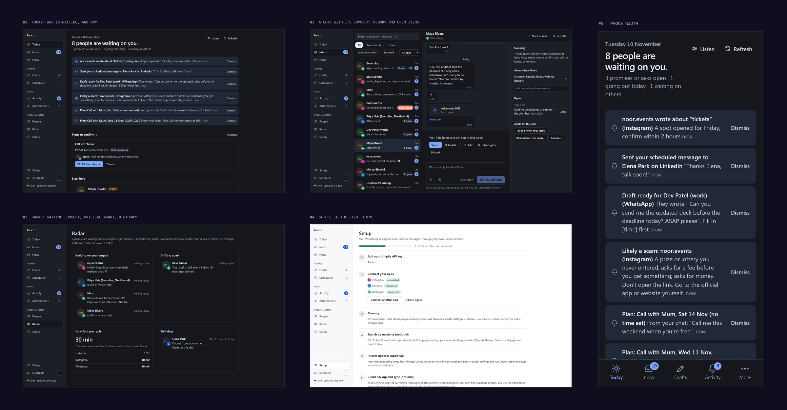

**Your WhatsApp, Instagram and LinkedIn messages in one Hermes inbox. Hermes drafts. You send.**


[Quick start](#quick-start) · [See it work](#see-it-work) · [Your yes](#nothing-leaves-without-your-yes) · [What it does](#what-it-does-for-you) · [Inbox page](#the-inbox-page) · [Built the Hermes way](#built-the-hermes-way) · [How it works](#how-it-works) · [Boundaries](#boundaries) · [Your data](#your-data) · [Reference](#reference)

## The one that mattered got buried

Messages arrive in three apps. Most of them can wait. One can't, and it is usually the one you
miss:

- a landlord who needs an answer tonight,
- a recruiter waiting on your availability before Friday,
- a ticket offer that expires in two hours.

You don't need one more app to check. You need someone to read all three, tell you who is
waiting and why, and have a reply ready in your own words. Hermes is named after the messenger
of the gods, the one who crosses between worlds. unified-inbox lets it carry yours: it reads
WhatsApp, Instagram and LinkedIn, ranks what needs you, drafts the way you write, and sends
nothing until you have seen the person, the app and the exact words, and said yes.

## See it work


*The real Inbox page, on the fictional chats the tests use. Today says who is waiting. A draft
waits in Drafts, written in your words and translated into the language of the chat. **Send…**
shows the person, the app, your words, what they will get and how much of your daily limit is
left. One press sends it, once.*

## Nothing leaves without your yes

> *Kēryx, the herald.* In Homer, a messenger repeats the message in the sender's exact words.



Hermes sends with `inbox_send`, and only after **Hermes's own approval prompt** has shown you
the person, the app, the exact text and any files: in the terminal, in Hermes Desktop, or as
buttons in your messaging app. Approve once and it is sent; deny and nothing happens. The AI
cannot skip this prompt: if Hermes would approve without asking you (yolo mode, approvals turned
off, an unattended cron run), the send is refused instead.

| Outcome | What happens |
|---|---|
| **Send** | The message goes out once. The next send unlocks after a random 45–90 seconds. |
| **Cancel**, no answer, or timeout | Nothing is sent. The draft stays saved. |
| A safety rule fails | Nothing is sent. Every failing rule is listed. |
| Running from cron or unattended | Nothing can be sent, except a message you scheduled and confirmed yourself. |

A saved draft is sent the same way with `/inbox send <id>` (**Send** / **Cancel**) or from the
Inbox page. A scheduled message goes out only after you confirmed it with `/inbox schedule` or on
the Inbox page, and every rule is checked again at send time.

## Quick start

You need Hermes Agent 0.23 or later and your own [Unipile](https://www.unipile.com) account (API v2)
with the apps you want connected. There is no sample mode: the plugin works only with your real
accounts.

**1. Install the plugin**

```bash
hermes plugins install krushna-sahu1/unified-inbox --enable
```

**2. Add your Unipile API key**

Create a key in the [Unipile dashboard](https://dashboard.unipile.com) (API keys, API v2), then
paste it in **Hermes → Settings → Plugins → unified-inbox → Unipile API key**. It is masked and
kept in Hermes's credential store. Until it is set, every tool and command answers with a short
setup message.

**3. Connect your apps**

Open the **Inbox** page (web dashboard tab or Hermes Desktop sidebar) and go to **Setup →
Connect an app**. Unipile's page opens: scan the QR code (or use a pairing code) for WhatsApp, or
log in for Instagram and LinkedIn. Press **Check again** and the app shows as connected. You can
also connect apps in the Unipile dashboard. Every WhatsApp, Instagram and LinkedIn account in
your Unipile app is used; to use only some, list their `acc_…` IDs in the optional
**Only these Unipile accounts** setting. Step-by-step help for Instagram and LinkedIn is in
[Connecting Instagram and LinkedIn](#connecting-instagram-and-linkedin).

**4. Use it**

Start a new Hermes chat and ask:

```text
What needs a reply in my inbox?
Draft a reply to Priya saying Thursday 3-5pm works.
/inbox drafts
/inbox send <id>
```

## What it does for you

Each capability below is one plain sentence and one thing to say to Hermes. The middle column is
the part of Hermes's myth it answers to.

| Capability | Hermes as… | Ask Hermes |
|---|---|---|
| **One inbox.** WhatsApp, Instagram and LinkedIn in one synced, local view. The same person on two apps becomes one profile once you confirm it. | the one god who crosses between three realms | "Anything new?" |
| **Who needs you.** Every active chat ranked: urgent ones, unanswered ones, each with a one-line reason. Who has waited longest, who you are drifting from, birthdays. | the guide who leads travellers where they must go | "What needs a reply?" |
| **Drafts in your voice.** Learned from messages you typed, per app. A draft is ready for an urgent message before you ask. Never sent on its own. | Logios, patron of eloquence | "Draft a reply to Priya saying Thursday 3-5pm works." |
| **Translation.** Messages in a language you don't read arrive translated; your reply is translated into theirs and still shown in your words. | the interpreter: *hermeneutics* is traditionally traced to his name | "What does Lena's message say?" |
| **Scam warnings.** OTP grabs, fake bank and KYC messages, prize and job scams, look-alike links, in English, Hindi and Hinglish. A reply that would leak a code is stopped. | the trickster, who knows every trick | "Is this a scam?" |
| **Memory of people.** Facts, chat summaries, what you promised and what you are waiting for, with due dates. It asks when unsure instead of guessing. | Agoraios, god of the marketplace where everyone meets | "What did I promise Maya?" |
| **Plans into your calendar.** "Kal shaam 6 baje milte hain" becomes a suggested plan, checked against when you are busy. | Hodios, guardian of the road you are about to take | "Am I free Thursday at 4?" |
| **A brief you can hear.** What you missed, written to be heard and played with Hermes's own voice. Dictate replies, too. | the maker of the first lyre | "What did I miss?" |
| **Work while you're away.** Scheduled messages, reply watches, follow-ups with a ready nudge, snoozes, morning and evening reports. | the wearer of the winged sandals | "Remind me if Marco hasn't replied by Friday, and draft a nudge." |

## The Inbox page



One place for all three apps, in the Hermes web dashboard (an **Inbox** tab) and in Hermes
Desktop (an **Inbox** item in the sidebar). You never need to open WhatsApp, Instagram or
LinkedIn. It follows the host's light or dark theme and works down to phone width. In Hermes
Desktop, new alerts also arrive as native notifications while the app is in the background.

| Section | What it shows |
|---|---|
| **Today** | Alerts, who needs a reply (and why), what you promised or owe, what goes out today, who you are waiting on, and memory's questions with one-tap answers |
| **Inbox** | Every chat, newest first, filtered by *Needs reply*, *Unread*, *Waiting on them* or *Snoozed* and by app. Search finds exact words and, with search by meaning, related conversations. `j` / `k` move, `/` searches |
| **Chat** | The conversation, with a side panel: summary, what is remembered about the person (add or remove facts), open items, and alerts for this chat (*tell me when they reply*, *remind me if no reply*, *snooze*). Write a reply and it is saved as a draft |
| **Drafts** | Each draft with **Send…** (shows the person, app and exact text; you confirm) and **Schedule…** (type "kal subah 9 baje" or "fri 18:30" and see the exact time before confirming) |
| **Scheduled** | What is waiting to go out, and what happened to recent ones (sent, held, missed, not sent) |
| **Plans** | Plans found in your chats, whether you are free, and **Add to calendar** |
| **Activity** | Alerts, reminders and everything sent, in time order |
| **People** | What Hermes remembers about each person, editable |
| **Radar** | Who is waiting longest, who you are drifting from, how fast you reply, birthdays |
| **Safety** | Chats that look like a scam, and a checker for any text |
| **Automations** | Keyword and topic watches across all chats, and the report blueprints |
| **Setup** | Connection steps, connected apps (reconnect in one click), memory, search by meaning, instant updates and your safety limits |

The page talks to the plugin through `/api/plugins/unified-inbox/` behind the dashboard's login.
Sending from the page follows the same rules as `/inbox send`: the request must carry the exact
text you confirmed, every safety limit is checked, and only one send runs at a time across all
Hermes windows and processes.

## Built the Hermes way

unified-inbox does not sit next to Hermes; it plugs into the parts Hermes already has.

| Hermes surface | How unified-inbox uses it |
|---|---|
| **Tools** | 22 `inbox_*` tools ([list](#tools)) that read the local copy, so most answers are instant |
| **Approval prompt** | A `pre_tool_call` hook puts every `inbox_send` and `inbox_react` through Hermes's own approval, and blocks the send when approval would be skipped |
| **Command** | `/inbox` with 20 subcommands ([list](#the-inbox-command)), from `status` to `doctor` |
| **Skill** | The `inbox` skill tells Hermes which tool answers which question, loaded only when relevant |
| **Auxiliary task** | Memory, drafts and translation run as their own task, **Inbox memory**, so you can point it at a cheaper model in **Settings → Models → Auxiliary** |
| **Cron blueprints** | Inbox daily digest, evening wrap-up, weekly review and alerts, from `/blueprint` or the Desktop Cron page |
| **Credential store** | The Unipile key, embedding key, calendar address and Supabase keys are secret settings; the plugin reads no credential files |
| **Dashboard and Desktop** | An **Inbox** tab in the web dashboard and an **Inbox** page in the Desktop sidebar, one shared backend, native notifications |
| **Voice** | Hermes's speech-to-text for voice notes and dictation, its text-to-speech for the spoken brief |
| **Gateway** | New alerts delivered to a chat of your choice with `/inbox alerts here` |

It is tested the same way: 461 tests run offline against fictional chats, plus
`hermes plugins validate` and `hermes plugins doctor`. See [How it is tested](#how-it-is-tested).

## How it works


**1. Stay in sync.** While Hermes runs, a background sync checks your apps for new messages and
keeps a local copy, so Hermes answers "anything new?" instantly without asking the apps. It reads
only what changed: one page of chats per app, then just the new messages of the chats that moved.
It uses at most half of the hourly request budget, so your own requests always have room. On an
always-on machine you can switch on [real-time updates](#real-time-updates) instead of waiting
for the next check.

**2. Read in small, paced batches.** Every request (yours or the sync's) goes one at a time, with
a short random pause between requests and an hourly request budget.

**3. Remember.** After each check, Hermes's language model reads what is new in each chat (once
a burst of messages has settled) and keeps a short summary, facts about the person and a list of
open items. When something is unclear, it asks you instead of guessing. See [Memory](#memory).

**4. Triage.** Each active chat is scored on its latest unanswered messages: urgent wording,
questions, how many messages are waiting and how long.

**5. Draft.** Hermes saves replies as drafts. A draft is a row in a local database. Nothing else
happens.

**6. You approve.** Every message needs your yes, as described in
[Nothing leaves without your yes](#nothing-leaves-without-your-yes). Every safety rule is checked
first. If one fails, you see why and nothing is sent.

## Boundaries

> *Hermai.* Stone pillars of Hermes marked the boundaries between fields and the crossroads.

unified-inbox paces itself like a careful person, not a bot. Limits can be made stricter in
settings; anything looser than the hard limit is capped.

| Rule | Default | Hard limit |
|---|---|---|
| **New conversations** | At most 5 a day to people who have not written to you in the last week (0 = replies only) | 20 |
| **Reply window** | A chat counts as a reply if they wrote within 7 days; older chats count as new conversations | 14 days |
| **Messages per 24 hours** | 20 across all apps | 40 |
| **WhatsApp / Instagram / LinkedIn per 24 hours** | 15 / 10 / 10 | 30 / 20 / 20 |
| **Messages per hour** | 5 | 8 |
| **Messages to one chat per hour** | 2 | 3 |
| **Gap between sends** | Random 45–90 seconds | At least 20 seconds |
| **No copy-paste messages** | Same or near-same text (20+ characters) to a different person is blocked for 24 hours | At least 24 hours |
| **One at a time** | One confirmed message per command; no bulk sending. Scheduled messages are confirmed one by one and re-checked at send time | 20 waiting, 30 days ahead |
| **Quiet hours** | Off; set e.g. `23:00-07:00` | — |

### Reading and errors

- Requests fetch 20 chats or messages at most, up to 5 pages per call.
- A random 2–5 second pause separates requests, with at most 120 requests per hour.
- A chat list or chat read in the last 30 seconds is reused instead of asked for again; search and
  triage reuse message reads for 10 minutes. The digest checks at most 15 active chats.
- Search uses a local full-text index that matches any part of a word in any script (English,
  Hindi, Hinglish), so it stays fast as the cache grows.
- Cached chats and messages older than 180 days (`cache_retention_days`) are deleted once a day.
- Messages are never marked as read unless you ask (`inbox_mark_read`, the page), or turn on
  `mark_read_after_reply`.
- Files people send are downloaded only when you open one (at most 25 MB), kept 30 days, and
  removed when their message is deleted.
- **Rate limited (HTTP 429):** never retried. The account waits at least Unipile's `retry-after`,
  backing off from 1 to 30 minutes (an hour after three limits in a row), and you get a plain
  message saying what happened and when to try again. A draft hit by a rate limit stays saved.
- **Account disconnected:** all calls for that account stop until it is reconnected in Unipile.
- **Account restricted or provider send limit reached:** that account pauses for 24 hours.
- **Server errors:** reads retry at most twice. Sends are never retried; if delivery is uncertain
  you are told to check the app, and the attempt still counts against your limits.

## Memory, scams, plans, languages and people

### Memory

Hermes keeps context the way ChatGPT and Claude do: small, current, and fetched only when needed,
so it never feels heavy.

- **About people.** Lasting facts from one-to-one chats ("Priya is a recruiter at Northwind",
  "Mum's birthday is 4 June"), saved automatically. Group chats get a summary but no personal
  facts.
- **About chats.** A rolling summary of at most 80 words per chat, updated as messages arrive.
- **Open items.** Questions you have not answered, things you promised, things you are waiting
  for, with due dates when a time is mentioned (Hindi "kal" and "parso" included).
- **One person across apps.** "Priya" on WhatsApp and "Priya Nair (Recruiter, Northwind)" on
  LinkedIn (or the Instagram handle priya_nair92) look like the same person: Hermes asks you once.
  It never links by itself, never guesses between two people with the same first name, and never
  asks again after a no. After a yes they are one profile: one name, facts from every chat, and
  every chat's summary and open items together; "message Priya" goes to the app you last used with
  her. Link, unlink or rename someone yourself ("Priya on WhatsApp and LinkedIn is the same
  person", or the People page).
- **Asks when unsure.** A fact it is not sure of, a change to something it knew, two chats that
  may be one person, an unclear "kal": these become questions. Hermes asks them one at a time at a
  calm moment. Until you answer, nothing uncertain is saved.
- **Search by meaning (optional).** Pick a cloud embedding provider (OpenAI, Gemini, Cohere or
  Voyage AI; all handle Hindi and Hinglish) and paste its key. Then searching "rent" also finds
  "kiraya bhej dena". Install `sqlite-vec` (`pip install sqlite-vec`) to make this search faster
  on large inboxes; without it, search still works.
- **Your control.** Tell Hermes "remember that…" or "forget what you know about…". Codes,
  passwords, card, bank and ID numbers are removed before anything is sent to a model or provider
  and are never saved.
- **Cost.** One small model call per chat with new messages (plus one per auto-draft, and one a
  week for your writing style), at most 200 a day (`memory_llm_calls_per_day`). It runs on its own
  auxiliary task, so you can point it at a cheaper model in **Settings → Models → Auxiliary →
  Inbox memory**. Embeddings are capped at about 750,000 tokens a day. Both caps are settings.

Memory uses Hermes's own language model. If your Hermes has no plugin model access, memory is
off and everything else works.

### Drafts in your voice

**Ready before you ask.** When an urgent message arrives, Hermes drafts a reply right away and
alerts you ("Draft ready for Maya (WhatsApp)"). It never sends: review it with `/inbox drafts`
and send it with `/inbox send <id>`. One draft per urgent moment; none when you already replied,
already have a draft for that chat, or the chat is muted, archived or snoozed; in a group, only
when someone mentions you; never for old history. A detail only you know is left as a blank like
`[time]`: fill it in (edit the draft) before it can be sent. If you answer in the app yourself, the
draft is withdrawn. `auto_draft_per_day` (20) caps it; 0 turns it off.

**In your style.** The plugin learns how you write from messages you typed (never from what
Hermes sent): how long, how formal, emojis, greetings and sign-offs, Hinglish or Hindi, and how
that differs between WhatsApp, Instagram and LinkedIn. Every draft Hermes writes follows it, using
a few of your own recent messages to that person as examples. Ask Hermes "how do I write?" to see
it, or "forget my writing style"; `style_learning` turns it off.

### Scam warnings

Every new message is checked on this machine, with fixed rules (no model, nothing sent anywhere),
in English, Hindi and Hinglish: asking for a one-time code or PIN ("code bata do", "I sent you a
code by mistake"), money or gift cards, a fee for a prize or a job, scanning a QR code to
"receive" money, installing a screen-sharing app; fake bank, KYC, police, courier or electricity
messages; prizes, "guaranteed returns", task jobs; and links that hide where they go (short links,
bare IP addresses, look-alikes such as `paypa1.com` or `sbi-kyc-update.xyz`, `.apk` files). Signs
add up and a stranger counts as one more, so "send me 500 for dinner" from a friend stays quiet.
A likely scam gets an alert and a warning on the message, is listed apart in triage (never as
"urgent"), and is never auto-drafted. **A reply that would share a code, password, card or account
number with such a chat is stopped**, however it is sent. Mark a chat safe to silence it
(`scam_shield`).

### Plans into your calendar

"Let's meet Thursday 4pm", "call tomorrow at 10", "kal shaam 6 baje milte hain" become a suggested
plan with one alert. Add it with a ready Google Calendar or Outlook link, or an `.ics` file for any
calendar app; nothing is written to a calendar by itself. Give it your calendar's private iCal
address (`calendar_ics_url`, read-only, optional) and it knows when you are busy, including
repeating, moved and cancelled events. An auto-draft for a proposed time is told whether you are
free (only the busy times, never what the other event is) and never accepts a clash
(`plan_detection`).

### Translation

Messages in a language you don't read are translated into `my_language` by Hermes's model, as
they arrive (`auto_translate`, batched, within memory's daily cap, with codes and passwords removed
first) or when you ask. Languages you write in yourself, and `also_read`, are never translated. To
reply in theirs, translate your draft: it follows your style, and the draft keeps what you wrote,
so every approval shows it "in your words".

### People radar

Who has waited longest for you (people, not groups, strangers or scams), who you are drifting from
compared with how often you used to talk (across all their apps), your reply time this week
against the four weeks before, and birthdays in the next two weeks (from memory, a "happy
birthday" you sent, or "my birthday is on 12 March"). A reminder the day before, and a weekly
summary (`people_radar`). Local, no model.

### Talk to your inbox

Ask Hermes "what did I miss?": `inbox_brief` answers in a few spoken-style sentences (who is
waiting and why, likely scams, drafts ready, today's plans and birthdays), and with Hermes's own
text-to-speech it becomes a voice note in your messaging app. On the Inbox page you can play it,
and dictate a reply with Hermes's speech-to-text (the recording is deleted right after).

## Automation

**Scheduled messages.** Ask Hermes to draft a reply and suggest a time, or schedule one yourself:

```text
/inbox schedule a1b2c3 tomorrow 9am
/inbox schedule a1b2c3 kal subah 9 baje
/inbox schedule a1b2c3 in 2h
```

You see the person, the app, the exact text and the time, and confirm. Times like "at 6" ask
"morning or evening?" instead of guessing. At that time every safety rule is checked again:

| At send time | What happens |
|---|---|
| All rules pass | Sent once. You get an alert. |
| They wrote again after you scheduled it | **Held**, not sent, so it doesn't ignore what they said. You get an alert. |
| A short wait (gap between sends, hourly limit) | It waits, up to `schedule_grace_minutes` (30). |
| A hard limit (daily limits, quiet hours, 7-day reply window) | Not sent. You get the reason. |
| Hermes was off at that time | Never sent late. Marked **missed**; you get an alert. |
| Sending was cut off half-way | Marked **unknown** and never retried; you are asked to check the app. |

Scheduled messages need Hermes running at that time, but not the background sync. At most 20
can wait at once, up to 30 days ahead. Cancel one with `/inbox schedule cancel <id>`; the draft
stays saved.

**Watches and reminders.** Just ask Hermes:

| You say | Hermes sets |
|---|---|
| "Tell me when Priya replies" | a reply watch (fires once) |
| "Tell me if anyone mentions the invoice" | a keyword watch (any language) |
| "Let me know if someone writes about the flat" | a topic watch, judged by meaning (uses the model) |
| "Remind me if Marco hasn't replied by Friday, and draft a nudge" | a follow-up: resolved if he replies, otherwise a reminder and a ready draft (never sent) |
| "Snooze Maya until tonight" | the chat is hidden from triage until then, then you are reminded |

**Alerts.** Watches, reminders and scheduled-message results become alerts. Hermes mentions them
the next time you check (`inbox_updates`, `/inbox alerts`). To be told right away:

- **In a chat of your choice:** run `/inbox alerts here` in that chat, and allow it once in
  `config.yaml` with `plugins.entries.unified-inbox.allow_gateway_injection: true`. New alerts
  arrive there batched into one message. `/inbox alerts off` stops it.
- **On a schedule:** add the **Inbox alerts** blueprint (every 5–30 minutes). It stays silent
  when there is nothing to report. Each check is one model call.

**Reports.** Three more blueprints, from `/blueprint` or the Desktop Cron page: **Inbox daily
digest** (morning), **Inbox evening wrap-up** (who is still waiting, promises due tomorrow, what
is scheduled) and **Inbox weekly review** (who you haven't answered all week, open promises,
who deserves a follow-up). Schedule the digest with `/blueprint daily-digest`, pick a time, how
far back to look and how many drafts to prepare, and each morning you get a short list like this:

```text
URGENT
- Maya Rivers (WhatsApp), 3h: plumber needs confirming tonight. Draft ready.
- Priya Nair (LinkedIn), 4h: availability for a call before Friday. Draft ready.
UNANSWERED
- lena.makes (Instagram), 12h: collab request, asked a question.

Review drafts with /inbox drafts and send one with /inbox send <id>.
```

## Sending, in detail

Ask in plain words, on any of the three apps:

```text
Message Suraj: hello Suraj, this msg from hermes agent
Send +91 98765 43210 on WhatsApp: are we still on for 5pm?
Send invoice.pdf to Priya on LinkedIn and say "as discussed"
Reply to @lena.makes on Instagram: yes, let's collab!
```

| You give | Works for |
|---|---|
| A name from your chats ("Suraj") | all three apps; if several people match, Hermes asks which one |
| A phone number with country code | WhatsApp, including people you have never chatted with |
| A LinkedIn profile link | LinkedIn, including people you have never chatted with |
| An Instagram @username or profile link | Instagram, including people you have never chatted with |

To answer one message, Hermes passes its id (`reply_to`) and it is sent as a quoted reply; the
approval prompt shows which message you are answering. In a group, `@Name` mentions that person
(they are notified), and the prompt says it is a group. Ask Hermes to "like" or "heart" a message
and it reacts with `inbox_react`, after the same approval prompt (6 reactions an hour, 30 a day).

Files: up to 5 per message, 15 MB each (WhatsApp sends each file as its own message). The
approval prompt names each file with its folder. Key, password and login files (`.env`,
`auth.json`, SSH and GPG keys, `.pem`, password-manager vaults) and the plugin's own data folder
are never attached, whoever asks. Every [boundary](#boundaries) still applies, and messaging
people who have not written to you recently has its own daily limit (`new_conversations_per_day`,
5 by default; 0 = replies only).

**See what happened.** `/inbox log` lists every send: when, which app, to whom, what, and whether
it was **sent**, **failed**, **blocked** (and why) or **waiting/declined**. The same list is on the
Inbox page under **Activity**, and in a plain file, `activity.log`, next to the plugin's database
(`<hermes home>/plugin-data/unified-inbox/`).

## Connecting Instagram and LinkedIn

WhatsApp, Instagram and LinkedIn all connect the same way, through your Unipile account. After
connecting, nothing else is needed: every connected app is used automatically.

**Instagram**

1. Open the Inbox page → **Setup** → **Connect an app** (or the
   [Unipile dashboard](https://dashboard.unipile.com) → **Accounts** → **Connect an account**).
2. Pick **Instagram** and log in with your Instagram username and password.
3. Instagram may ask for a code (SMS, email or authenticator) or a "Was this you?" check in the
   Instagram app: approve it. Turn off any VPN first; logins from a new place trigger more checks.
4. Back on the Inbox page, press **Check again**. Instagram shows as connected.

Unipile keeps its own Instagram session. If you change your password or log out of all sessions,
reconnect from Setup (**Reconnect**). You can message an @username or profile link you have never
chatted with; it counts as a new conversation (Instagram watches new outreach closely, so the daily
limit for new chats applies).

**LinkedIn**

1. Inbox page → **Setup** → **Connect an app** (or the Unipile dashboard → **Accounts** →
   **Connect an account**).
2. Pick **LinkedIn** and log in with your LinkedIn email and password.
3. Approve the sign-in in the LinkedIn app, or enter the code LinkedIn sends you.
4. Press **Check again**. LinkedIn shows as connected.

The connection appears in LinkedIn → Settings → Sign in & security → *Where you're signed in*.
Don't end that session, or it disconnects. You can message your connections. Messaging people
outside your network needs InMail (LinkedIn Premium) or a connection request first. LinkedIn
allows about 100–150 messages a day; the plugin's own limits stay well below that. If logging in
with a password keeps failing (common with Sales Navigator or Recruiter), Unipile also accepts your
browser's LinkedIn session cookie; its connect page explains how.

## Real-time updates

Without any setup, new messages show up at the next background check. That is every 2 minutes
at most, slower while nothing is happening, and never faster than the request budget allows.
With three connected apps and the default budget, that works out to about every 6 minutes.

If Hermes runs on an always-on machine, Unipile can push each new message the moment it arrives:

1. Set `webhook_port` (for example `8787`) in the plugin settings and restart Hermes. A small
   receiver starts on `127.0.0.1:8787` at `/unipile/webhook`.
2. Make a public `https://` address forward to it, through your reverse proxy or a tunnel. Opening
   that address in a browser shows `unified-inbox webhook receiver` when it works.
3. Run `/inbox webhook setup https://your.domain/unipile/webhook`.

Every delivery is checked against Unipile's signature (HMAC-SHA256, at most 5 minutes old);
anything unsigned or forged is rejected. Redeliveries are applied once. While webhooks are
arriving, polling drops to a check every 15 minutes, which catches anything a delivery missed.
`/inbox webhook remove` turns it off again.

## Cloud sync (optional)

Everything stays on your machine by default. Turn on cloud sync to keep a synced copy in **your
own** Supabase project (the free plan is enough for a personal inbox) and to use the inbox from
more than one device.

1. Create a project at [supabase.com](https://supabase.com/dashboard/new).
2. In **Hermes → Settings → Plugins → unified-inbox**, paste the **Project URL**
   (`https://<ref>.supabase.co`) and the **secret key** (Supabase: Settings → API Keys,
   `sb_secret_…`).
3. On the Inbox page, **Setup → Cloud backup and sync**: with an optional Supabase **access
   token** in settings ([create one](https://supabase.com/dashboard/account/tokens)), press
   **Create tables and start syncing**; or press **Copy setup SQL**, paste it in the Supabase SQL
   editor, run it, then **I've run it**. (From chat: `/inbox cloud sql`, then `/inbox cloud setup`.)

Your current data is copied up, then every change syncs both ways: chats and messages, drafts,
scheduled messages, the send log, memory (facts, open items, questions, summaries), watches,
alerts, and conversation windows with their embeddings (pgvector), so another device can search
by meaning without paying to embed again.

- **Local-first.** Pages and tools still read the local copy, instantly and offline. Sync runs in
  the background about every minute, and right after anything you change.
- **One device does the background work.** A lease in Supabase picks one device to read
  Unipile, build memory and send scheduled messages. The others mirror it and never call
  Unipile, so two devices don't double your request budget. If that device goes quiet, another
  takes over within a few minutes.
- **Limits count every device.** Before any send, the latest sends from all devices are pulled,
  and only one device sends at a time. A scheduled message is claimed in Supabase first, so it is
  sent once, and one cancelled on another device is never sent.
- **Fails closed.** If Supabase can't be reached, sending pauses (with a plain message) rather
  than risk going over your limits. Reading and drafting keep working.
- **Locked down.** The tables (`inbox_*`) have Row Level Security on with no policies, so the
  publishable key sees nothing. Only the secret key, kept in Hermes's credential store, can read
  them. Deleted items sync as tombstones and are purged after 30 days.
- **Keeps a free project awake.** Free projects pause after a week without use; regular sync
  counts as use.

`/inbox cloud` shows the status; `/inbox cloud sync` syncs now. Removing the URL turns sync off;
local data stays.

## Your data

> *Argeiphontes.* Hermes lulled Argus, the hundred-eyed watchman, to sleep.

No telemetry. Your inbox lives on your machine, and you stay in control of it:

- **Export everything:** `/inbox export`, or **Setup → Your data → Export everything**. A JSON
  file with your chats, messages, drafts, scheduled messages, sends and the activity log, memory,
  watches and alerts (no embeddings, no keys). It holds your messages, so keep it private.
- **Forget a person:** `/inbox forget <name>`, or **People → Forget this person**. Removes the
  facts, chat summary, open items, search index, plans and translations for their chats. Their
  messages stay, since they are your inbox (and Unipile would bring them back anyway).
- **Delete everything:** `/inbox reset`, or **Setup → Delete everything** (type DELETE). This
  includes the activity log and `activity.log`. Exports you saved stay where you saved them. Sends
  from the last 7 days and rate-limit pauses are kept on purpose: without them the plugin could
  send more than your limits allow. With cloud sync you choose: this device only (your Supabase
  copy is kept and sync stops here), or everywhere (Supabase and your other devices too).
- **Health check:** `/inbox doctor`, or **Setup → Run a check**. Checks the key, each connected
  app, the database, search, background sync, memory, search by meaning, webhooks and cloud sync,
  and says how to fix anything that is off.

The database is in Hermes's plugin data folder. On macOS and Linux it, `activity.log` and your
exports are readable by you alone; on Windows your user profile already is. The activity log
(`/inbox log`) keeps 90 days; `activity.log` starts a new part past 1 MB, keeping the previous
one as `activity.log.1`. For more protection, use your system's disk encryption (FileVault,
BitLocker, LUKS). The plugin does not encrypt the database itself, because that would make search
much slower and need extra software.

### What it touches

- **Network:** the Unipile API v2 at `https://api.unipile.com/v2`, and, only if you set them up,
  your embedding provider, your calendar's iCal address and your own Supabase project
  (`https://<ref>.supabase.co`, plus `https://api.supabase.com` once if you use the access token
  to create the tables). Memory goes through Hermes's own model connection. Message text sent to
  a model or provider has codes, passwords, card, account and ID numbers removed first. No
  telemetry. The webhook receiver, if you turn it on, only accepts deliveries signed with your
  endpoint's secret.
- **Local data:** drafts, a send log, synced chats and messages, an event log of what changed
  (kept 30 days), memory (facts, summaries, open items, conversation windows and their embeddings)
  and pacing state, in SQLite under `<hermes home>/plugin-data/unified-inbox/data.db`. The webhook
  signing secret is kept there too. The database upgrades itself in place. Attachments are
  described (`[voice note]`, `[file: cv.pdf]`). A file someone sent is downloaded only when you
  open it, into `attachments/` next to the database (kept 30 days); a voice note's text, once you
  ask for it, is kept with the message. Voice notes are turned into text with Hermes's own
  speech-to-text (your `stt` setting; local Whisper by default).
- **Credentials:** read only through Hermes's secret store. The plugin never reads `.env`,
  `auth.json` or any other credential file, and stores no keys of its own.
- **Inbox page:** `dashboard/manifest.json`, `dashboard/dist/index.js` and
  `dashboard/plugin_api.py` (web dashboard tab), `desktop/plugin.js` (Hermes Desktop). The page
  loads nothing from the internet; it uses the host's React.
- **Background work:** one worker thread while Hermes runs (only one process runs it at a time)
  for the sync, memory, scheduled messages and watches, and the webhook receiver thread if
  `webhook_port` is set. Turn the sync off with `sync_enabled`; scheduled messages still go out.
- **Nothing else:** no shell commands, no self-updates. The digest is an ordinary Hermes cron job
  you schedule.

### Unofficial access

Unipile states that it reaches WhatsApp, Instagram and LinkedIn through reverse engineering, not
official APIs. Using it may break those platforms' terms, and accounts can be restricted. The
pacing above lowers that risk; it cannot remove it. You are responsible for how your accounts are
used.

## Reference

### Tools

Twenty-two tools for Hermes:

| Tool | Purpose |
|---|---|
| `inbox_status` | Connection, accounts, pauses, sends used against each limit |
| `inbox_list_chats` | Recent chats across all three apps, with unread counts |
| `inbox_read_chat` | The latest messages of one chat, with their files, quotes and reactions |
| `inbox_search` | Exact words first (any language), then conversations related by meaning |
| `inbox_triage` | Urgent and unanswered chats, with reasons |
| `inbox_updates` | New messages and alerts since you last asked, grouped by chat (instant) |
| `inbox_context` | A compact brief on one person: facts, chat summary, open items, latest messages |
| `inbox_loops` | Who is waiting on you, who you are waiting on, promises and due dates |
| `inbox_memory` | See, add or forget what is remembered; answer memory's questions |
| `inbox_send` | Send a message and files to a person, or reply to one message; Hermes asks you to approve first |
| `inbox_react` | React to a message with an emoji; Hermes asks you to approve first |
| `inbox_attachment` | Open a file someone sent (photo, PDF, voice note...), or turn a voice note into text |
| `inbox_mark_read` | Mark a chat as read, only when you ask |
| `inbox_schedule` | Propose a send time for a draft (you confirm it), list or cancel scheduled messages |
| `inbox_watch` | Alerts and reminders: when someone replies, keywords, topics, follow-ups, snoozes |
| `inbox_draft_reply` | Save a draft reply (never sends) |
| `inbox_list_drafts` | Drafts waiting for you |
| `inbox_safety` | Chats that look like a scam, check any text, mark a chat safe |
| `inbox_calendar` | Plans found in chats, whether you are free, add one to your calendar |
| `inbox_translate` | Translate a chat into your language, or your draft into theirs |
| `inbox_radar` | Who is waiting longest, who you are drifting from, your reply time, birthdays |
| `inbox_brief` | What you missed, written to be heard (and as audio with Hermes's voice) |

### The /inbox command

```text
/inbox status          connected accounts, sends used vs limits (per app)
/inbox drafts          drafts waiting for approval
/inbox send <id>       review one draft and send it
/inbox discard <id>    delete a draft
/inbox schedule <id> <when>   schedule a draft (asks you to confirm); /inbox schedule cancel <id>
/inbox scheduled       scheduled messages
/inbox brief           what you missed, in a few lines
/inbox radar           who is waiting longest, who you are drifting from, birthdays
/inbox plans           plans found in your chats
/inbox scams           chats that look like a scam
/inbox alerts          unread alerts; "here" sends new alerts to this chat, "off" stops it
/inbox log             what Hermes sent, to whom, and whether it worked
/inbox sync            check for new messages now
/inbox doctor          check every part and say how to fix what is wrong
/inbox export          save all your data to a JSON file
/inbox forget <name>   remove what memory knows about a person (asks first)
/inbox reset           delete all inbox data (asks first)
/inbox webhook         real-time updates: status | setup <public https URL> | remove
/inbox cloud           cloud sync: status | sync | sql | setup
/inbox limits          the safety limits in force
```

### Configuration

Settings live in **Hermes → Settings → Plugins → unified-inbox**.

| Setting | Default | Range |
|---|---|---|
| `unipile_account_id` | empty (all) | optional: only these `acc_…` IDs, separated by commas |
| `daily_send_limit` | 20 | 0–40 |
| `daily_limit_whatsapp` | 15 | 0–30 |
| `daily_limit_instagram` | 10 | 0–20 |
| `daily_limit_linkedin` | 10 | 0–20 |
| `hourly_send_limit` | 5 | 0–8 |
| `per_chat_hourly_limit` | 2 | 0–3 |
| `min_send_gap_seconds` | 45 | 20 and up; a random 0–100% is added |
| `reply_window_days` | 7 | 1–14 |
| `new_conversations_per_day` | 5 | 0–20; messages to people who have not written to you in the last week |
| `quiet_hours` | off | e.g. `23:00-07:00` |
| `mark_read_after_reply` | off | mark a chat as read after you reply in it |
| `unanswered_hours` | 4 | when a waiting chat counts as unanswered |
| `cache_retention_days` | 180 | 7–3650; older cached chats and messages are deleted |
| `sync_enabled` | on | background check for new messages |
| `poll_seconds` | 120 | 60–3600; shortest gap between background checks |
| `sync_budget_percent` | 50 | 10–80; share of the hourly request budget the sync may use |
| `webhook_port` | 0 (off) | local port of the real-time receiver; restart Hermes after changing |
| `webhook_host` | `127.0.0.1` | address the receiver listens on |
| `memory_enabled` | on | summaries, facts and open items (needs Hermes's language model) |
| `memory_llm_calls_per_day` | 200 | 0–5000 |
| `auto_draft_per_day` | 20 | 0–100; drafts prepared by themselves for urgent chats (0 = off) |
| `style_learning` | on | learn how you write from your own messages |
| `scam_shield` | on | warn about messages that look like a scam |
| `plan_detection` | on | find plans in chats and offer them for your calendar |
| `calendar_ics_url` | empty | optional: your calendar's private iCal address (read-only, credential store) |
| `my_language` | English | messages in other languages are translated into this one |
| `also_read` | empty | other languages you read, e.g. `Hindi, Hinglish` (languages you write in count too) |
| `auto_translate` | on | translate new messages in other languages as they arrive |
| `people_radar` | on | birthday reminders and a weekly people summary |
| `embedding_provider` | none | `openai`, `gemini`, `cohere` or `voyage` for search by meaning |
| `embedding_api_key` | empty | that provider's key (kept in Hermes's credential store) |
| `embedding_model` | provider default | `text-embedding-3-small`, `gemini-embedding-2`, `embed-v5.0-fast`, `voyage-4-lite` |
| `embedding_chars_per_day` | 3,000,000 | characters sent for embedding per day |
| `schedule_grace_minutes` | 30 | 5–240; how late a scheduled message may still go out |
| `supabase_url` | empty (off) | your project's URL to turn on cloud sync |
| `supabase_secret_key` | empty | the project's secret key (credential store) |
| `supabase_access_token` | empty | optional: lets the plugin create the tables for you |

### How it is tested

```bash
uv run --no-project --with "pytest>=8,<9" python -m pytest -q -W error tests
python scripts/build_ui.py --check   # the built page matches ui/
python scripts/dev_server.py         # preview the page on fictional chats: http://127.0.0.1:8765
python scripts/bench.py              # speed at 100,000 messages, against targets
hermes plugins validate . --install-deps
hermes plugins doctor . --ci
```

The 461 tests run offline against fictional chats that exist only in `tests/fixtures`. They cover
every pacing rule, the confirm-before-send flow, reading, search (including Hindi and Hinglish),
triage and drafting on all three apps, cache reuse, database upgrades and pruning, the background
sync (incremental reads, no history flood, budget share, one worker across processes, thread
safety), webhooks (signatures, redeliveries, a real local receiver), memory (redaction,
conversation windows, re-embedding only what changed, search by meaning with and without
sqlite-vec, facts, questions, open items, daily caps, model failures), automation (time phrases in
English and Hindi, scheduled sends that go out once, are held, wait, fail, are missed or are never
retried; reply, keyword, topic, follow-up and snooze watches; batched alert delivery), the four
embedding request formats, the Unipile v2 request format, the Inbox page's API (routing, setup
gating, sending only the exact confirmed text, scheduling, one send at a time across processes,
the FastAPI adapter) and that the built page is current and valid JavaScript, cloud sync (the
locked-down schema, headers, copying up, two devices mirroring each other, one leader, scheduled
messages sent once and never after a cancel elsewhere, limits across devices, failing closed,
embeddings shared, no lost changes), your data (export without secrets, forgetting a person,
deleting everything while keeping what the limits need, on one device or everywhere), the health
check, that hot queries use their indexes, that versions and settings agree, that no keys or
machine paths are committed, messaging (files downloaded once, kept in the plugin folder and
cleaned up, voice notes as text, quoted replies, reactions and their limits, mark as read, group
mentions, new Instagram chats, files served safely to the page), and error handling: rate limits
(no retry, clear message), disconnects, restrictions and server errors.

The README art is built by `python scripts/build_readme_art.py --png`; the screenshots and the
demo come from the dev server above, on the same fictional chats.

---

MIT licensed. An independent community plugin for
[Hermes Agent](https://github.com/NousResearch/hermes-agent), not affiliated with or endorsed by
Nous Research, Unipile, Meta (WhatsApp, Instagram) or LinkedIn. WhatsApp, Instagram and LinkedIn
names and logos are trademarks of their owners and are used only to show which apps the plugin
connects to. All names and messages in the test fixtures and screenshots are fictional.
